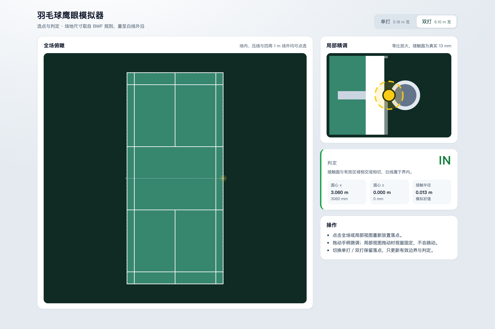

# 羽毛球鹰眼模拟器

在球场上放置固定圆形落点并判断界内／界外。纯前端应用，使用 TypeScript、React、Vite 和 SVG。

球场尺寸取自 BWF《Laws of Badminton》，一律量至白线外沿，白线属于界内区域；接触圆半径 13 mm 为模拟初值，待样片确认。设计依据见 `docs/PRD.md` 与 `docs/TECHNICAL_DESIGN.md`。

## 当前可用

- 单打／双打切换，显示对应有效区域、标准球场线与球网。
- 全场俯瞰与局部等比放大两个视图，点击重新放置落点，拖动手柄微调，两视图同步。
- 场内、压线、相切与场外落点都可设置；接触圆与有效区域相交或相切为 IN，完全分离为 OUT。
- 局部视图按真实比例显示 13 mm 接触圆与 40 mm 白线，压线与出界的差别可分辨。
- 切换赛制保留圆心，只更新有效边界与判定。

来球方向、三维回放与视频导出不在本阶段范围内。



## 安装与运行

需要 Node.js 20 或更高版本。

```bash
npm install
npm run dev -- --host 127.0.0.1
```

打开终端输出的本地地址（默认 <http://127.0.0.1:5173/>）。

## 构建与测试

```bash
npm run build   # TypeScript 类型检查 + 生产构建，输出到 dist/
npm test        # Vitest 单次运行，覆盖几何与判定用例
npm run preview # 预览构建产物
```

## 目录

```
src/domain/      球场常量、圆与矩形判定、视图窗口
src/components/  球场几何、可交互的 SVG 视图
src/App.tsx      布局、赛制切换与判定展示
docs/            产品需求、技术方案、交付计划
```

## 判定口径

有效矩形为 `x ∈ [-W/2, W/2]`、`z ∈ [-6.7, 6.7]`，`W` 取双打 6.10 m 或单打 5.18 m。取圆心到矩形的最近点，距离不超过半径即为 IN。角落按到角点的距离计算，不做轴向扩张，因此四角不会被误判为界内。比较带 1e-9 m 容差，避免浮点误差把相切误判为出界。
