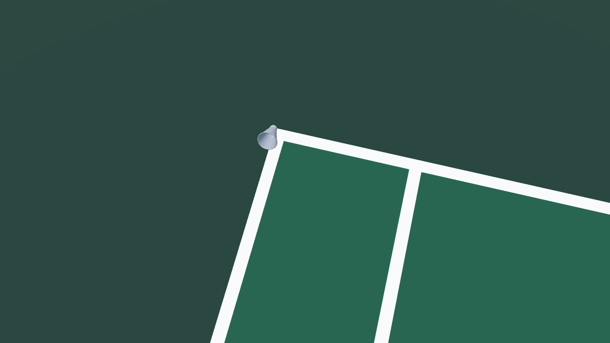
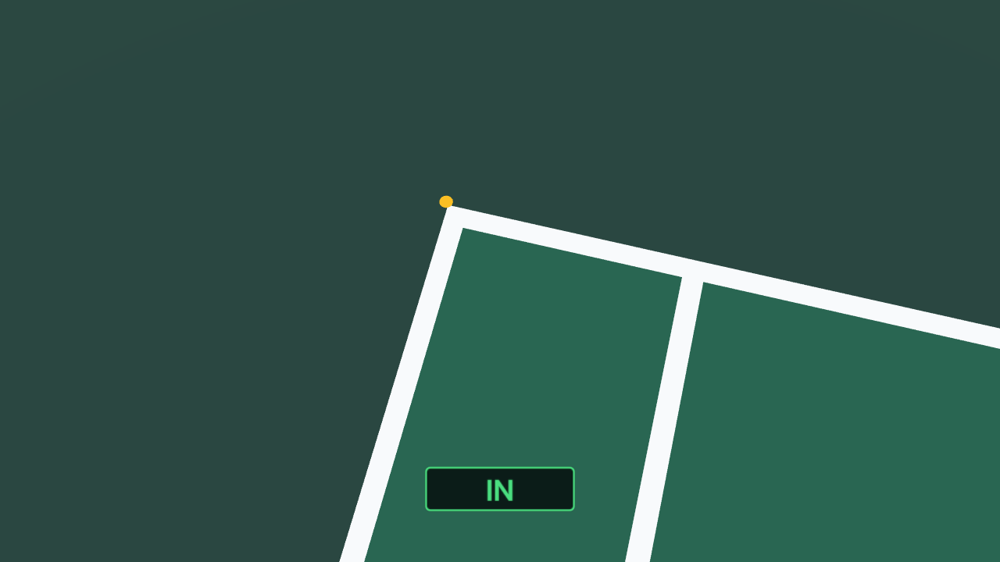
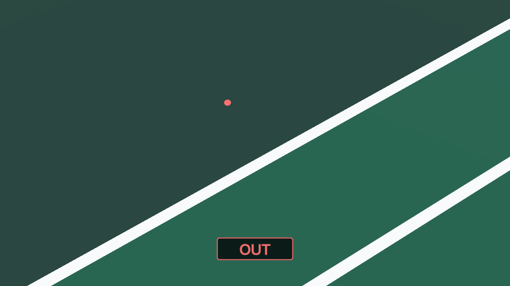

# 羽毛球鹰眼模拟器

在球场上放置固定圆形落点、指定来球方向，判断界内／界外，生成约 5 秒的三维落地回放，并导出 1920×1080 的 MP4。纯前端实现，使用 TypeScript、React、Vite、SVG 与 Three.js，运行时不访问网络。

球场尺寸取自 BWF《Laws of Badminton》，一律量至白线外沿，白线属于界内区域；接触圆半径 13 mm 为模拟初值，待样片确认。设计依据见 `docs/PRD.md`、`docs/TECHNICAL_DESIGN.md`、`docs/DELIVERY_PLAN.md`。


## 前置环境

| 项目 | 要求 |
| --- | --- |
| Node.js | `^20.19.0` 或 `>=22.12.0`（由 Vite 7 与 `@vitejs/plugin-react` 决定）；推荐 Node 22.12+ 或 24 |
| npm | 随 Node 提供，需要支持 `npm ci` |
| 浏览器 | 支持 WebGL 与 [WebCodecs](https://developer.mozilla.org/docs/Web/API/WebCodecs_API) 的现代桌面浏览器；导出另需 H.264 编码能力 |

本轮实测见文末「验证环境」，其他组合未验证。

## 安装

```bash
git clone https://github.com/fuhan666/badminton-hawkeye.git
cd badminton-hawkeye
npm ci
```

`npm ci` 会严格按 `package-lock.json` 安装，首次约需下载 160 余个包。只有 `package.json` 里的 11 个直接依赖是项目显式声明的，其余为传递依赖。

## 启动

```bash
npm run dev -- --host 127.0.0.1
```

终端会打印本地地址，默认 <http://127.0.0.1:5173/>。用浏览器打开即可，不需要后端或额外配置。

## 使用流程

1. **选赛制**：右上角「单打 / 双打」。切换只改有效边界与判定，两个点保留。
2. **放落点**：在「全场俯瞰」点击球场。场内、白线上、以及四周各 1 m 的场外都能选。
3. **放来向点**：在右侧「编辑目标」选「来向点」，再点一次球场。箭头由落点指向来向点。
4. **精调**：拖动黄色（落点）或蓝色（来向点）手柄；或聚焦球场后用方向键，每次 1 mm，按住 Shift 为 10 mm。右侧「局部精调」按真实比例显示 13 mm 接触圆与 40 mm 白线，压线与出界的差别可以直接看出来。
5. **看判定**：右侧「判定」面板给出 IN / OUT 与圆心毫米读数，「来向」面板给出单位方向与两点距离。
6. **预览**：右侧「三维回放」约 5 秒，可用「播放 / 暂停」、拖动时间轴查看任意时刻，改输入后自动回零。
7. **导出**：点右上角「导出视频」。进度从 0% 走到 100%，完成后浏览器自动下载 MP4（默认落在系统的下载目录）。导出期间可以继续编辑，本次文件仍使用点击时的设置。
8. **取消与重试**：导出途中点「取消」，立即停止送帧、丢弃半成品、不产生下载，按钮恢复可再次导出。

两点是同一目标时会提示「两点重合」，播放与导出保持禁用，把点拖开即恢复。

导出文件名形如 `badminton-hawkeye-doubles-x3.055-z3.200-20261116-152935.mp4`，包含赛制、落点米制坐标与时间戳。

## 构建与预览

```bash
npm run build     # tsc --noEmit 类型检查 + 生产构建，输出到 dist/
npm run preview -- --host 127.0.0.1   # 以静态服务器预览 dist/
npm test          # Vitest 单次运行
```

`npm run build` 会提示 chunk 大小超过 500 kB（Three.js + Mediabunny 打在同一入口），这是提示而非错误。构建产物是纯静态文件，可直接部署到任意静态托管。

## 回放样片

`docs/media/` 下的四个文件都由正式「导出视频」按钮生成，1920×1080 / 30 fps / 5 s / 无音轨。来向点都在落点正后方 3.2 m（方向 `(0, 1)`）。

| 样片 | 输入 | 判定 |
| --- | --- | --- |
| [doubles-line-in.mp4](docs/media/doubles-line-in.mp4) | 双打，落点 `3.055, 3.200`（压双打边线） | IN |
| [doubles-out.mp4](docs/media/doubles-out.mp4) | 双打，落点 `3.075, 3.200`（完全出界） | OUT |
| [singles-line-in.mp4](docs/media/singles-line-in.mp4) | 单打，落点 `2.595, 3.200`（压单打边线） | IN |
| [doubles-corner-in.mp4](docs/media/doubles-corner-in.mp4) | 双打，落点 `3.055, 6.705`（角落相交） | IN |

逐项验收记录（9 类场景、`ffprobe` 参数、预览与视频比对、取消重试）见 [docs/ACCEPTANCE.md](docs/ACCEPTANCE.md)。

静态截图，左右两列分别是触地时刻 3.2 s 与定格 4.6 s：

| 落点 (x, z) | 触地 3.2 s | 定格 4.6 s | 判定 |
| --- | --- | --- | --- |
| 压双打边线 `3.055, 3.2` |  |  | IN |
| 角落相交 `3.055, 6.705` |  |  | IN |
| 明显界内 `2.2, 3.2` |  |  | IN |
| 明显界外 `3.3, 3.2` |  |  | OUT |

## 当前可用

- 单打／双打切换，显示对应有效区域、标准球场线与球网。
- 全场俯瞰与局部等比放大两个视图，点击放置落点，拖动手柄微调，两视图坐标同步。
- 场内、压线、相切与场外落点都可设置；接触圆与有效区域相交或相切为 IN，完全分离为 OUT。
- 局部视图按真实比例显示 13 mm 接触圆与 40 mm 白线，压线与出界的差别可分辨。
- 方向按 `落点 - 来向点` 归一化为单位向量，两点距离不参与计算；同方向不同距离得到相同方向输入。
- 聚焦球场后可用方向键微调，每次 1 mm，按住 Shift 为 10 mm；+x 向右、+z 向下。
- 三维回放约 5 秒，四段分镜：球场全景 → 侧后方跟随 → 慢放触地 → 印记与 IN/OUT 定格；支持播放、暂停、重播与拖动时间轴。
- 导出正式 MP4：进度、取消、取消后重试都可用；取消不产生半成品下载，缺少 H.264 编码能力时给出明确提示，三维预览不受影响。
- 相同输入与时间得到相同画面：回放画面只由 `evaluateReplay(input, time)` 的纯函数结果决定。

## 已知限制

- 只验证了 Chrome（见下方「验证环境」）。Safari 与 Firefox 的 WebCodecs H.264 支持不一致，导出前请以界面提示为准。
- 导出规格固定为 1920×1080 / 30 fps / 5.000 s、无音轨，暂不提供多分辨率或音轨选项。
- 13 mm 接触半径、四段镜头节奏与视频规格仍是初始建议，等待所有者对样片的视觉确认。

## 判定口径

有效矩形为 `x ∈ [-W/2, W/2]`、`z ∈ [-6.7, 6.7]`，`W` 取双打 6.10 m 或单打 5.18 m。取圆心到矩形的最近点，距离不超过半径即为 IN。角落按到角点的距离计算，不做轴向扩张，因此四角不会被误判为界内。比较带 1e-9 m 容差，避免浮点误差把相切误判为出界。

## 方向口径

回放输入只包含赛制、落点与单位方向向量 `normalize(落点 - 来向点)`。来向点坐标与两点距离在计算后即丢弃，因此沿同一射线改变来向点距离不会改变回放输入。两点距离小于 10 mm 视为重合，不产生方向，界面提示调整并禁用播放与导出。

## 三维回放口径

`src/domain/replay.ts` 的 `evaluateReplay(input, time)` 是纯函数：不读时钟、随机数、帧率或上一帧结果，同一输入同一时刻逐字段相等。它返回球托底端位置、球体朝向、镜头位姿与 FOV、球体与印记透明度、判定结果；`src/replay/scene.ts` 只负责把这些数值搬到 Three.js 场景里，`ReplayPreview` 只用 `requestAnimationFrame` 的时间戳换算绝对播放秒数。

- 时间：总长 5 s，触地 3.2 s；分镜为 0–0.8 s 全景、0.8–2.0 s 跟随、2.0–3.6 s 慢放触地、3.6–5.0 s 印记与结果定格。
- 球路：从落点沿来向反推 4.2 m 起手，水平匀速、竖直下降，跨网时按需要抬升，保证常规跨网路径过网净高且最高点不超过 6 m。
- 模型原点：球体局部原点是球托底端，羽毛沿纵轴向后；触地时刻位置直接取落点圆心，不再插值。
- 镜头：四段关键帧共享段边界位姿，段间用三次 Hermite 过渡，位置、视点与 FOV 连续。
- 印记：半径固定为 `CONTACT_RADIUS`，只抬高 1.8 mm 避免与地面闪面，不放大判定圆。

## 导出实现

导出入口在 `src/export/`：`exportReplay.ts` 负责能力判断、逐帧渲染编码、封装与清理，`useExportJob.ts` 负责单个活动任务、进度状态与下载。导出使用独立画布与 `pixelRatio: 1`，与预览共享 `evaluateReplay` 和同一个 Three.js 场景，因此轨迹、触地点、印记与 IN/OUT 和预览一致；同一输入两次导出的画面相同。

- 编码 `avc1.420028`（H.264 Baseline）、8 Mbps、每 30 帧一个关键帧；时间戳 `round(i × 10⁶ / 30)`，最后一帧结束于 5,000,000 µs。
- 编码队列超过 8 帧时等待 `dequeue` 做背压，并定期让出事件循环，保证进度可见、取消可响应。
- 取消与失败都进入统一清理：关闭 `VideoEncoder`、丢弃未完成的封装、释放场景与画布；成功路径先 `flush` 再等写入链、`source.close()`、`output.finalize()`，完整封装后才触发下载。
- 能力判断只用 `VideoEncoder.isConfigSupported`，不按浏览器品牌推断。

## 目录

```
src/domain/         球场常量、圆与矩形判定、视图窗口、方向归一化、键盘微调、回放内核
src/components/     球场几何、可交互的 SVG 视图、三维预览、导出状态与播放控制
src/replay/         Three.js 场景：球场、球网、球体、印记与结果牌
src/export/         正式导出：能力判断、逐帧编码、封装、进度、取消与下载
src/App.tsx         布局、赛制与编辑目标切换、判定和入口门控
docs/               产品需求、技术方案、交付计划、验收记录、第三方说明
docs/media/         四个由正式导出生成的样片
tools/mp4-probe/    导出参数验证：逐帧渲染、H.264 编码、MP4 封装与播放验证
tools/export-smoke/ 正式导出路径的浏览器 smoke：固定场景、样片、取消重试与不支持提示
```

## 开发工具

两个脚本都会自己起 Vite 与无头浏览器，产物写到各自的 `out/`（已被 git 忽略），需要本机安装 Chrome 或 Edge。

`tools/mp4-probe` 是最初的参数验证工具：用固定回放输入跑「逐帧渲染 → WebCodecs H.264 → MP4 封装 → 浏览器播放」，用于确定编码参数与封装库。它不经过产品界面，不是正式导出路径。

```bash
npm run probe -- --browser chrome            # 也可用 --browser edge
npm run probe:typecheck                      # probe 的独立类型检查
```

`tools/export-smoke` 验证正式应用路径：按固定毫米输入逐项走判定，再导出四个样片、验证取消与重试、OUT 结果和不支持环境提示。它的落点与来向点都通过界面点击加方向键微调设定，并读回手柄坐标核对。

```bash
npm run smoke:export -- --browser chrome                    # 开发服务器
npm run build && npm run smoke:export -- --browser chrome --server preview
```

`--server preview` 用来确认 `dist/` 构建产物同样能完成导出。脚本输出 `samples/*.mp4`、状态截图、预览对照图与 `report.json`；只要有一个场景不符合预期，进程以非零状态退出。probe 默认端口 5199、smoke 默认 5201，可用 `--port` 改。

实测参数、封装选型另见 `docs/TECHNICAL_DESIGN.md` 的「视频导出」一节。

## 第三方依赖与许可证

运行时依赖 Mediabunny（MPL-2.0）、React / React DOM（MIT）、Three.js（MIT）；开发依赖见 [docs/THIRD_PARTY_NOTICES.md](docs/THIRD_PARTY_NOTICES.md)，其中列出直接依赖、传递依赖的许可证分布、Mediabunny 的 MPL 义务与素材来源。

本项目自身的许可证**待定**，由项目所有者选定后补充 `LICENSE`；在此之前请勿直接再分发。

## 验证环境

以下组合实际跑通了「安装 → 启动 → 选点 → 预览 → 导出 MP4」全流程：

| 项目 | 值 |
| --- | --- |
| 系统 | macOS（Darwin 27.0.0，Apple Silicon） |
| Node.js / npm | v24.13.0 / 11.13.0 |
| 浏览器 | Google Chrome 157.0.8103.51 |
| 验证日期 | 2026-11-16 |
| 验证路径 | `npm ci`、`npm run build`、`npm run preview`、`npm test`、`npm run smoke:export -- --browser chrome` 与 `--server preview` |

以上是唯一实测环境。页面操作由 smoke 脚本在无头 Chrome 里真实驱动（真实指针与键盘事件、真实下载），没有做人工肉眼观看的整体体验评估；Edge、Firefox、Safari 及 Windows / Linux 未验证。
