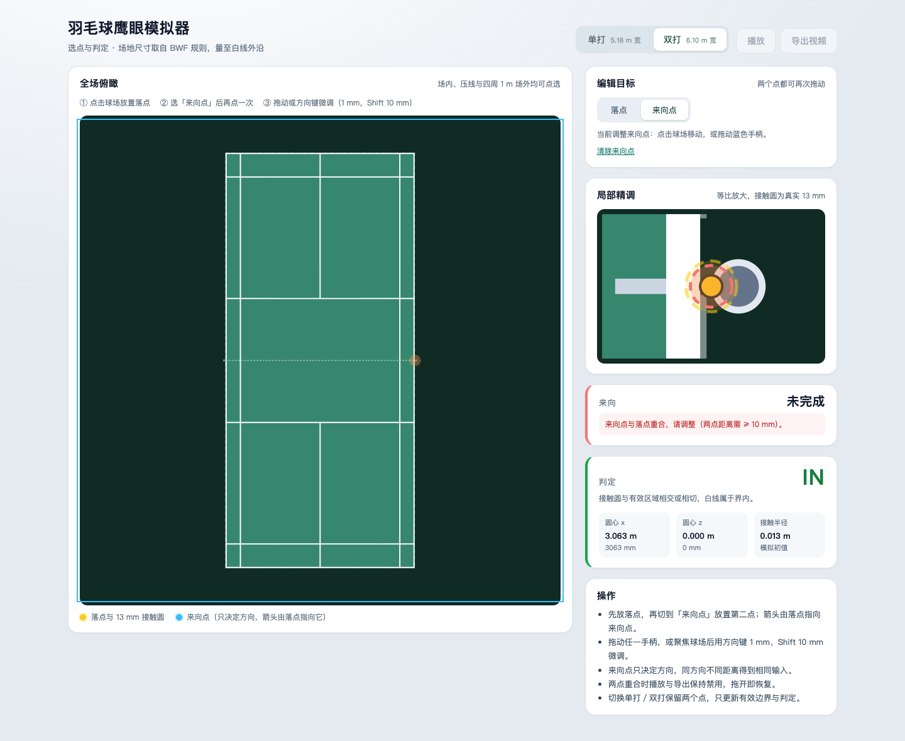
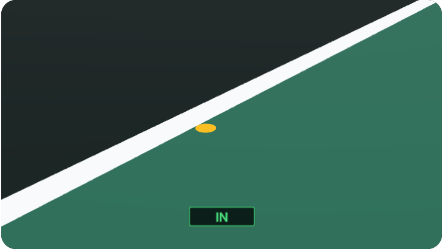

# 羽毛球鹰眼模拟器

在球场上放置固定圆形落点、指定来球方向，判断界内／界外，并生成可重播的三维落地回放。纯前端应用，使用 TypeScript、React、Vite、SVG 和 Three.js。

球场尺寸取自 BWF《Laws of Badminton》，一律量至白线外沿，白线属于界内区域；接触圆半径 13 mm 为模拟初值，待样片确认。设计依据见 `docs/PRD.md` 与 `docs/TECHNICAL_DESIGN.md`。

## 当前可用

- 单打／双打切换，显示对应有效区域、标准球场线与球网。
- 全场俯瞰与局部等比放大两个视图，点击放置落点，拖动手柄微调，两视图坐标同步。
- 场内、压线、相切与场外落点都可设置；接触圆与有效区域相交或相切为 IN，完全分离为 OUT。
- 局部视图按真实比例显示 13 mm 接触圆与 40 mm 白线，压线与出界的差别可分辨。
- 落点确定后再放一个来向点，箭头由落点指向来向点；两点都可再次拖动，也可用编辑目标切换。
- 方向按 `落点 - 来向点` 归一化为单位向量，两点距离不参与计算；同方向不同距离得到相同方向输入。
- 两点重合（距离小于 10 mm）时提示调整，播放与导出入口保持禁用；拖开后恢复。
- 聚焦球场后可用方向键微调，每次 1 mm，按住 Shift 为 10 mm；+x 向右、+z 向下。
- 切换赛制保留两个点，只更新有效边界与判定。
- 三维回放约 5 秒，四段分镜：球场全景 → 侧后方跟随 → 慢放触地 → 印记与 IN/OUT 定格。
- 球托底端落在编辑圆心，触地后球体淡出，13 mm 圆形印记与编辑圆同尺寸，白线用几何面绘制。
- 支持播放、暂停、重播与拖动时间轴查看任意时刻；改落点、方向或赛制后自动回零并采用新输入。
- 相同输入与时间得到相同画面：回放画面只由 `evaluateReplay(input, time)` 的纯函数结果决定。

视频导出尚未接入，导出入口只做输入门控，不会伪造下载。






## 操作

1. 点击全场图或局部图放置落点。
2. 在「编辑目标」选择来向点，再点击球场放置第二点；箭头随之出现。
3. 拖动黄色（落点）或蓝色（来向点）手柄，或在聚焦球场后用方向键微调。
4. 需要重做方向时点「清除来向点」，再重新放置。

## 安装与运行

需要 Node.js 20 或更高版本。

```bash
npm install
npm run dev -- --host 127.0.0.1
```

打开终端输出的本地地址（默认 <http://127.0.0.1:5173/>）。

## 构建与测试

```bash
npm run build   # TypeScript 类型检查 + 生产构建，输出到 dist/
npm test        # Vitest 单次运行，覆盖几何、判定、方向与微调用例
npm run preview # 预览构建产物
```

## 目录

```
src/domain/      球场常量、圆与矩形判定、视图窗口、方向归一化、键盘微调、回放内核
src/components/  球场几何、可交互的 SVG 视图、三维预览与播放控制
src/replay/      Three.js 场景：球场、球网、球体、印记与结果牌
src/App.tsx      布局、赛制与编辑目标切换、判定和入口门控
docs/            产品需求、技术方案、交付计划
```

## 判定口径

有效矩形为 `x ∈ [-W/2, W/2]`、`z ∈ [-6.7, 6.7]`，`W` 取双打 6.10 m 或单打 5.18 m。取圆心到矩形的最近点，距离不超过半径即为 IN。角落按到角点的距离计算，不做轴向扩张，因此四角不会被误判为界内。比较带 1e-9 m 容差，避免浮点误差把相切误判为出界。

## 方向口径

回放输入只包含赛制、落点与单位方向向量 `normalize(落点 - 来向点)`。来向点坐标与两点距离在计算后即丢弃，因此沿同一射线改变来向点距离不会改变回放输入。两点距离小于 10 mm 视为重合，不产生方向，界面提示调整并禁用播放与导出。

## 三维回放口径

`src/domain/replay.ts` 的 `evaluateReplay(input, time)` 是纯函数：不读时钟、随机数、帧率或上一帧结果，同一输入同一时刻逐字段相等。它返回球托底端位置、球体朝向、镜头位姿与 FOV、球体与印记透明度、判定结果；`src/replay/scene.ts` 只负责把这些数值搬到 Three.js 场景里，`ReplayPreview` 只用 `requestAnimationFrame` 的时间戳换算绝对播放秒数。

- 时间：总长 5 s，触地 3.2 s；分镜为 0–0.8 s 全景、0.8–2.0 s 跟随、2.0–3.6 s 慢放触地、3.6–5.0 s 印记与结果定格。
- 球路：从落点沿来向反推 4.2 m 起手，水平匀速、竖直下降，跨网时按需要抬升，保证常规跨网路径过网净高且最高点不超过 6 m。
- 模型原点：球体局部原点是球托底端，羽毛沿纵轴向后；触地时刻位置直接取落点圆心，不再插值。
- 镜头：四段关键帧共享段边界位姿，段间用三次 Hermite 过渡，位置、视点与 FOV 连续。
- 印记：半径固定为 `CONTACT_RADIUS`，只抬高 1.8 mm 避免与地面闪面，不放大判定圆。
