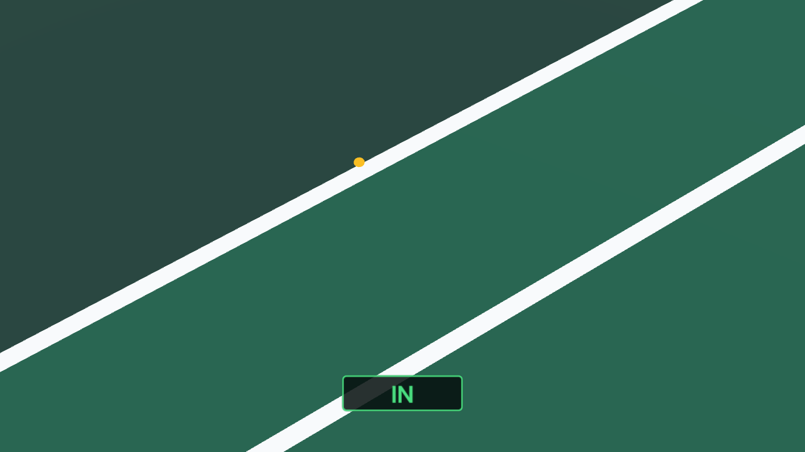
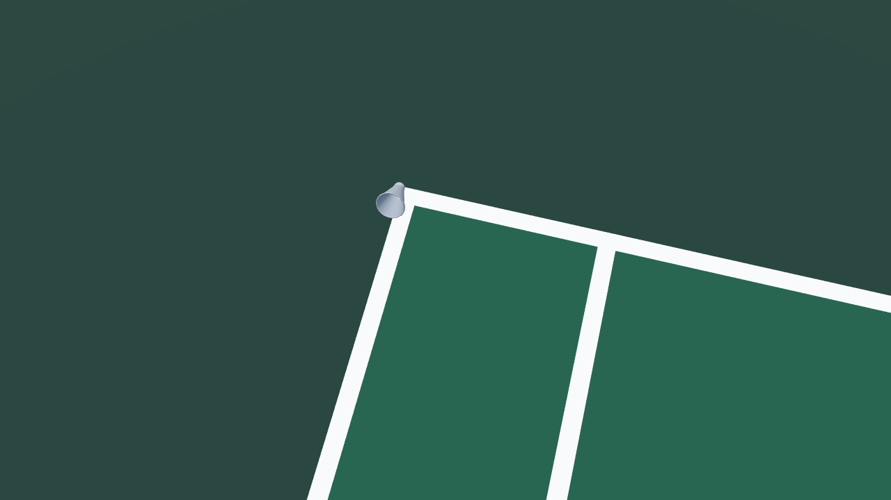
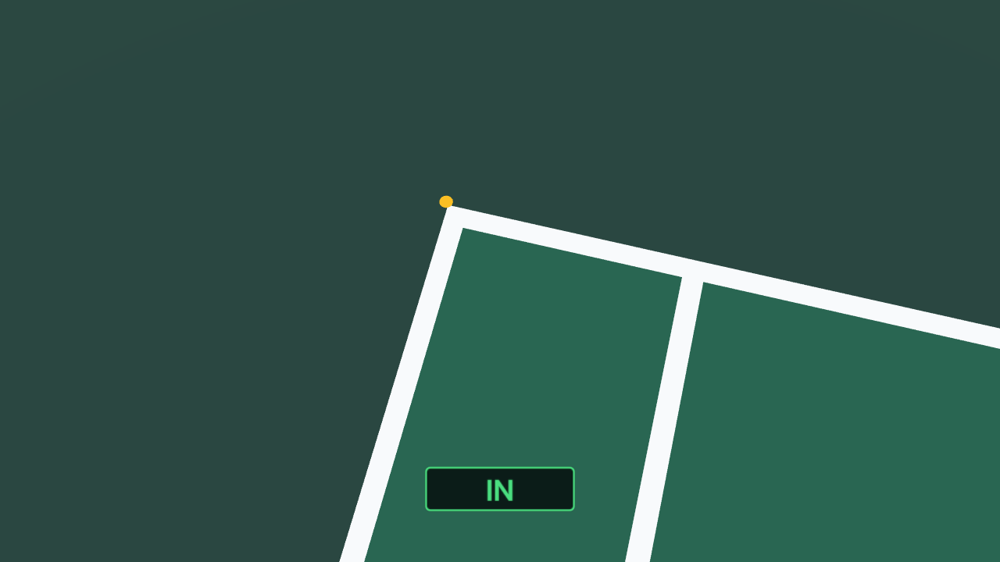
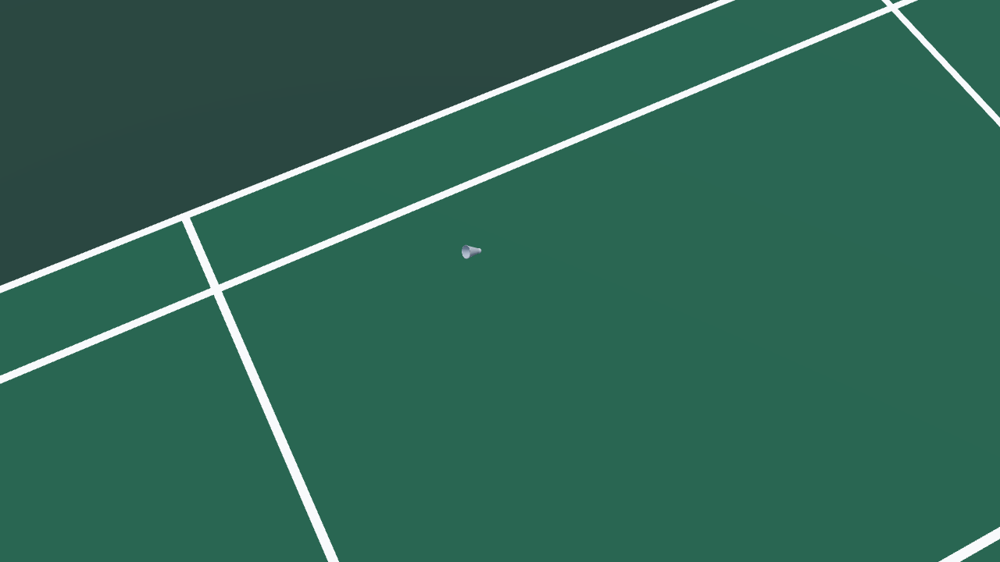
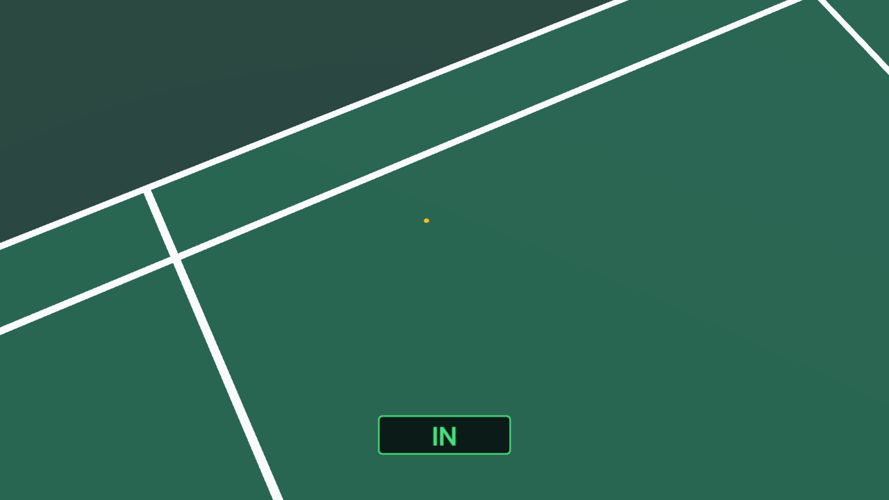
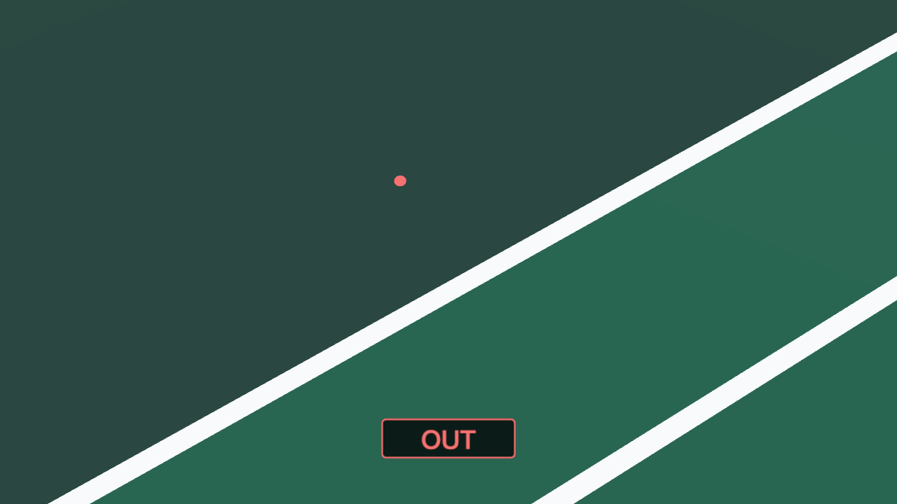

# 验收记录

按日期记录验证环境、方法与结果。几何判定、视频参数和任务状态通过测试或浏览器操作验证；画面一致性通过抽帧与像素比对检查。印记观感、运镜风格和节奏由项目所有者评估，单独记录，不阻塞已通过客观验证的交付。

## 2026-11-18：自定义导出与配色

环境为 macOS、用户现有 Chrome，分别操作开发页面和生产构建页面。记录的检查结果为：120 项单元测试、生产构建及 probe 类型检查通过。

### 导出规格

以下文件由正式「导出视频」入口下载，`ffprobe -count_frames` 读回均为 H.264 单视频流、5.000000 秒：

| 分辨率 | 帧率 | 帧数 | 验证路径 |
| --- | --- | --- | --- |
| 1080×1920 | 60 fps | 300 | 开发页面 |
| 1280×720 | 24 fps | 120 | 开发页面 |
| 1280×720 | 30 fps | 150 | 开发页面 |
| 1280×720 | 50 fps | 250 | 开发页面 |
| 2160×3840 | 60 fps | 300 | 生产构建，取消后重试 |
| 3840×2160 | 60 fps | 300 | 开发页面 |
| 960×960 | 25 fps | 125 | 开发页面 |

### 交互与画面

- 八项自定义颜色均可修改；切换预设后可返回自定义色板，播放位置保持 5.0 秒。
- 刷新后恢复配色模式、尺寸和帧率。损坏 JSON 记录恢复为绿色、1920×1080、30 fps；读取 API 抛错由单元测试覆盖。
- 4K60 样片抽帧可见自定义地胶、场线、印记和 IN 颜色；竖屏抽帧包含落点、参照线和结果牌。
- 375 px 配色浮层、320 px 自定义尺寸浮层可操作。
- 生产构建的 2160×3840、60 fps 导出可取消，取消后无新增半成品文件，重试下载成功；控制台未发现错误。

单元测试覆盖五档帧率、编码参数与校验、任务快照、9:16／9:20／1:1／4:3／21:9 构图，以及浏览器设置损坏处理。

本机补充产物位于 `tools/export-smoke/out/custom-settings/`，包括 `report.json`、`production-ui.jpg`、`custom-palette.jpg` 和 `portrait.jpg`。该目录被 Git 忽略，完整视频保存在本机下载目录。

## 2026-11-17：界面整理

构建与 77 项测试通过。使用用户现有 Chrome 检查桌面及 320／375 px 布局、选点精调、赛制切换、重合提示、暂停续播、换色和导出取消后重试。下载文件经 `ffprobe` 确认为 H.264、1920×1080、30 fps、5 秒。

## 2026-11-16：选点、回放与导出

### 环境与方法

| 项目 | 记录 |
| --- | --- |
| 系统 | macOS，Darwin 27.0.0，Apple Silicon |
| Node.js／npm | 24.13.0／11.13.0 |
| 浏览器 | Chrome 157.0.8103.51，无头模式，SwiftShader |
| 路径 | 开发服务器及生产构建分别运行 `smoke:export` |

落点与来向点通过正式界面的点击和键盘微调设置，判定读取界面结果，视频通过正式导出入口下载。

### 判定场景

坐标单位为米；下表检查落点与有效场地的关系。

| 场景 | 赛制 | 落点（X, Z） | 记录判定 |
| --- | --- | --- | --- |
| 场内 | 双打 | 2.200, 3.200 | IN |
| 部分压线 | 双打 | 3.055, 3.200 | IN |
| 外沿相切 | 双打 | 3.063, 3.200 | IN |
| 完全出界 | 双打 | 3.064, 3.200 | OUT |
| 角落相交 | 双打 | 3.055, 6.705 | IN |
| 角落外沿 | 双打 | 3.060, 6.710 | OUT |
| 同点单打 | 单打 | 2.700, 3.200 | OUT |
| 同点双打 | 双打 | 2.700, 3.200 | IN |

方向对比使用落点 `(3.055, 3.200)`、来向点 `(3.055, 0)` 与 `(3.055, -3.2)`。两者单位方向均为 `(0, 1)`，3.2 秒预览截图的 SHA-256 一致。

### 仓库样片

以下样片均为 1920×1080、30 fps、150 帧、5.000000 秒的 H.264 MP4，包含一条视频流，无音轨。来向点为 `(landing.x, landing.z - 3.2)`，球体沿 +Z 飞向落点：

| 样片 | 落点（X, Z） | 判定 |
| --- | --- | --- |
| [双打压线](media/doubles-line-in.mp4) | 3.055, 3.200 | IN |
| [双打出界](media/doubles-out.mp4) | 3.075, 3.200 | OUT |
| [单打压线](media/singles-line-in.mp4) | 2.595, 3.200 | IN |
| [双打角落](media/doubles-corner-in.mp4) | 3.055, 6.705 | IN |

压线样片与预览在 3.2 秒、4.6 秒的触地点和判定一致；视频帧缩放至预览尺寸后，记录的 PSNR 约为 26.5 dB。编码到 23% 时取消，下载目录无新文件，随后重试得到完整视频。模拟缺少 `VideoEncoder` 时，界面提示不支持导出，预览仍可渲染。

对应画面示例：

| 场景 | 触地 3.2 s | 定格 4.6 s |
| --- | --- | --- |
| 双打压线 |  |  |
| 双打角落 |  |  |
| 双打界内 |  |  |
| 双打界外 |  |  |

独立 MP4 probe 另记录了 Chrome 157 和 Edge 153.0.4234.48 的 1080p30 编码与播放验证；Edge 的记录仅覆盖该工具路径。

## 验证范围与视觉评估

完整界面流程记录来自 Chrome；Firefox、Safari 及 Windows／Linux 界面流程尚无验证记录。新增导出规格的覆盖范围以上表为准。

2026-11-16 样片观察记录包含两项视觉问题：结果牌半透明背景可透出白线，明显出界样片的印记与白线间距在透视下偏小。接触半径、印记和镜头的视觉确认状态见[产品需求](PRD.md#回放)。
